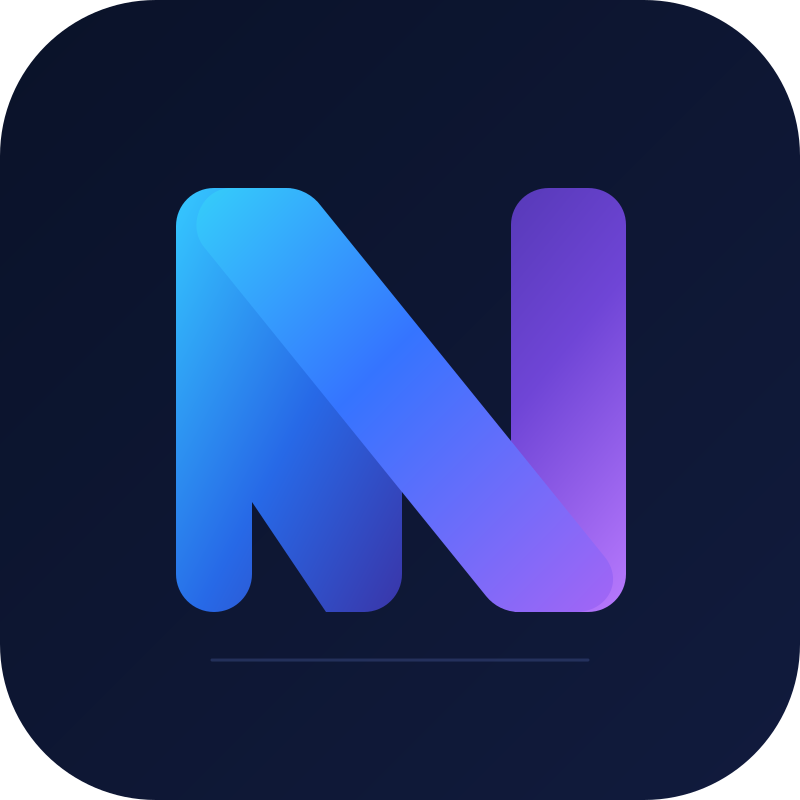

# NEXIVON

### Intelligent Software • AI • Automation

**Building smarter digital experiences through code, artificial intelligence, and automation.**

---

### About

Welcome to **Nexivon**.

I build practical software solutions focused on **AI**, **automation**, and **digital products**.  
My goal is to create useful tools that simplify workflows, improve productivity, and turn ideas into working systems.

### Focus Areas

- Artificial Intelligence & Intelligent Tools
- Workflow Automation
- Web Applications
- Mobile Applications
- API Integrations
- Open-Source Software

### Technologies & Interests

### Featured Projects

- **Kira Takip**
  - Rental and payment tracking system
  - Bank integration and workflow automation

- **AI Automation Tools**
  - Productivity-focused tools powered by AI
  - Experiments with intelligent workflows and assistants

- **Mobile App Projects**
  - Practical app ideas and implementation experiments
  - Focused on usability and real-world value

### GitHub Activity

---

**NEXIVON**  
*Think. Build. Improve.*

